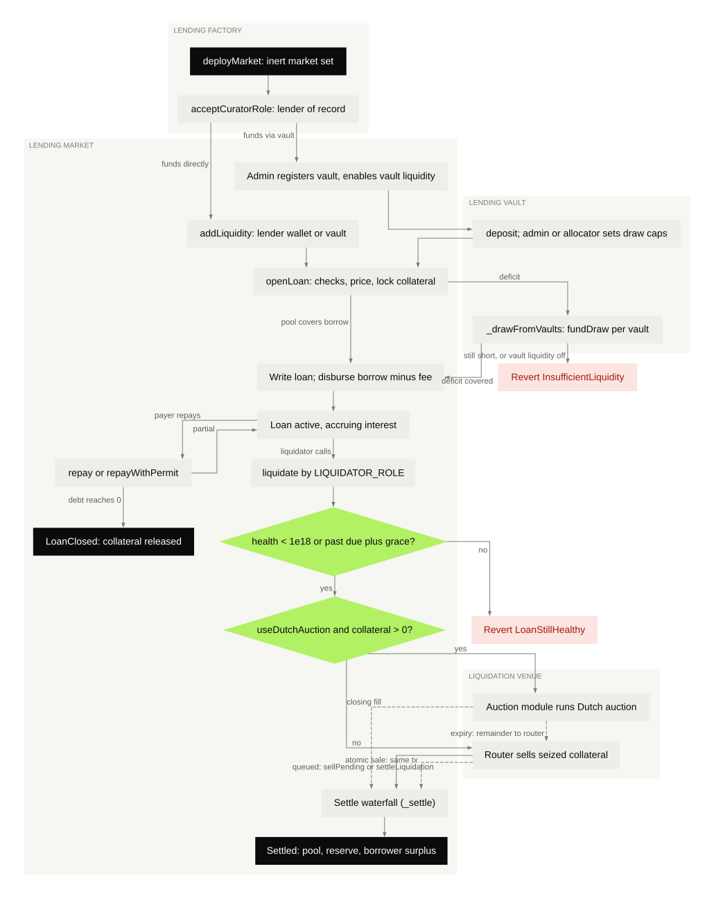
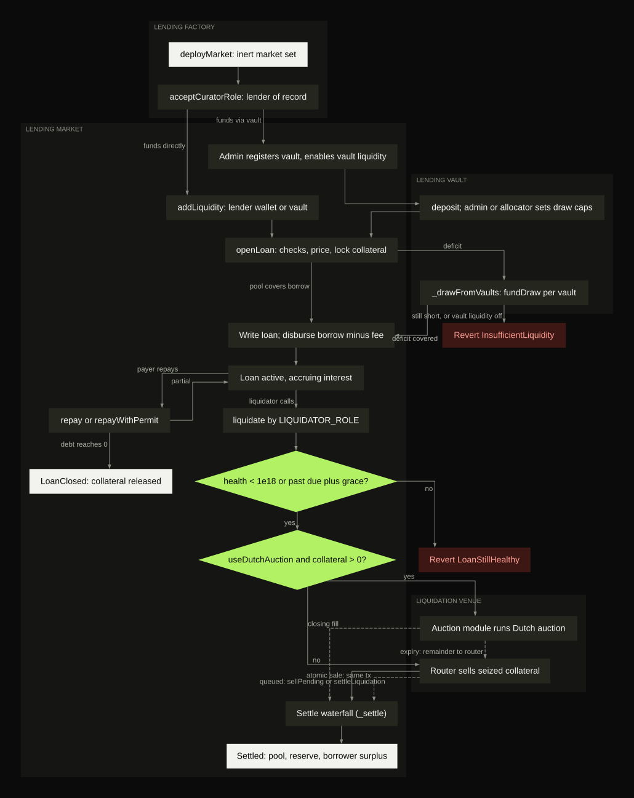

Every page in these docs builds on five objects: the lending market, the lender of record, the position, the pledge and the vault. This page defines each one once, then follows a single loan from the first draw to a partial liquidation.

## The five objects

**Lending market.** One collateral token, one collateral mode and one settlement token (stablecoin). The factory deploys it in one transaction together with its price oracle, interest rate model, insurance fund, collateral adapter and a liquidation router of its own. A new market names no parties and takes no loans. It is **seeking a lender of record**.

**Lender of record.** The licensed institution that takes the market. Taking it names every party: the admin, the issuer, the collateral agent, the price signer, the sale recipient and the liquidation operator. It also fixes how seized collateral is realized. The wallet that signs the adoption becomes the market's **operator wallet**. Trusset admits only institutions it approved as lenders of record. See [Lender of record](/endpoints/lending/introduction#lender-of-record).

**Position.** A borrower's loan on one market: the collateral pledged, the debt drawn, and the health factor that compares the two. A position can carry a term with a due date. [Open Loan](/endpoints/lending/open-loan) creates it and [Get Position](/endpoints/lending/get-position) reads it.

**Pledge.** The lock on the collateral. A `FREEZE` market freezes the tokens in the borrower's own wallet and names the collateral agent as pledgee. A `CUSTODY` market moves them into the market's adapter. The lock on chain is not the register entry: the register provider makes that entry, from the facts [List Pledges](/endpoints/asset-register/list-pledges) returns.

**Vault.** The lender of record's earning product. Depositors put in the settlement token and receive shares. The operator places the pooled funds on the markets it approved, and a market it consented to can draw on the vault when a loan needs the liquidity. Apart from registered vaults, only the operator wallet deposits into a market directly. See [Vaults](/endpoints/vaults/introduction).

A sixth party matters to fintechs: the **distributor**. A vault deposit built through [Deposit](/endpoints/vaults/deposit) names the calling instance as the depositor's distributor. Once the vault owner approves that distributor, it earns a fixed share of the interest those deposits produce.

The chart shows the same lifecycle on chain, across the factory, the vault, the market and the liquidation venue.

<Frame caption="Market lifecycle on chain">
  
  
</Frame>

## Loan-to-value and the health factor

Two limits govern every position, both set by the market's issuer role in basis points with [Update Market Config](/endpoints/lending/update-config).

The **collateral factor** caps new borrowing. A borrower can draw at most the collateral value times the collateral factor. The **liquidation threshold** is the loan-to-value at which a position becomes liquidatable. It must sit above the collateral factor, so every borrower starts with a buffer.

The **health factor** reads `1.0` exactly where the loan-to-value reaches the liquidation threshold. Above `1.0` the position is healthy. Below it, a wallet holding the liquidator role can liquidate. A position with a term can also be liquidated once its due date plus grace has passed, whatever its health.

## A loan, step by step

The market in this example prices its collateral by net asset value and runs in `FREEZE` mode. The settlement token is USDC. Its issuer role set these limits:

| Parameter | Value | Meaning |
|---|---|---|
| `collateralFactor` | `7000` | Borrow up to 70 percent of the collateral value |
| `liquidationThreshold` | `8000` | Liquidatable above 80 percent loan-to-value |
| `closeFactor` | `5000` | One liquidation discharges at most half the debt |
| `liquidationPenalty` | `500` | Seized collateral is marked up 5 percent |

Interest is left out to keep the arithmetic readable. In practice it accrues every second and raises the debt between steps.

##### Monday, 09:00. The borrower draws

The price signer has published a net asset value of 100.00 USDC per token. The borrower pledges 250 tokens, worth 25,000 USDC, so the most it can draw is 17,500 USDC. It draws 15,000 USDC with [Open Loan](/endpoints/lending/open-loan). The tokens stay in its wallet, frozen.

| Collateral | Value | Debt | Loan-to-value | Health factor |
|---|---|---|---|---|
| 250 tokens | 25,000 USDC | 15,000 USDC | 60.0% | 1.33 |

##### Wednesday, 09:00. The price falls

The price signer publishes 85.00. The position is still healthy, but its debt now exceeds 70 percent of the collateral value, so [Borrow More](/endpoints/lending/borrow-more) is refused until the borrower adds collateral or repays.

| Collateral | Value | Debt | Loan-to-value | Health factor |
|---|---|---|---|---|
| 250 tokens | 21,250 USDC | 15,000 USDC | 70.6% | 1.13 |

##### Wednesday, 10:00. The borrower tops up

The borrower pledges 50 more tokens with [Add Collateral](/endpoints/lending/add-collateral).

| Collateral | Value | Debt | Loan-to-value | Health factor |
|---|---|---|---|---|
| 300 tokens | 25,500 USDC | 15,000 USDC | 58.8% | 1.36 |

##### Friday, 09:00. The price falls through the threshold

The price signer publishes 60.00. The loan-to-value passes 80 percent and the health factor drops below `1.0`. [Get Liquidatable Loans](/endpoints/lending/get-liquidatable-loans) now lists the position with the trigger `HEALTH`.

| Collateral | Value | Debt | Loan-to-value | Health factor |
|---|---|---|---|---|
| 300 tokens | 18,000 USDC | 15,000 USDC | 83.3% | 0.96 |

##### Friday, 09:05. A partial liquidation

A wallet holding the liquidator role calls [Liquidate Loan](/endpoints/lending/liquidate). The close factor limits this call to half the debt, 7,500 USDC. The penalty marks the seizure up to 7,875 USDC, which is 131.25 tokens at 60.00. The position is healthy again.

| Collateral | Value | Debt | Loan-to-value | Health factor |
|---|---|---|---|---|
| 168.75 tokens | 10,125 USDC | 7,500 USDC | 74.1% | 1.08 |

The 131.25 seized tokens go to the market's liquidation router. On a router in two-step mode they do not sell themselves. The router operator withdraws them to the sale recipient the lender of record fixed, sells them through its own channel, reports the proceeds and settles. The market keeps at most the debt it discharged plus the penalty, here 7,875 USDC. Proceeds above that go back to the borrower. See [Liquidations](/endpoints/lending/introduction#liquidations).

## Where the interest goes

Repaid interest splits in a fixed order. Trusset's infrastructure fee comes first. The operator and distributor shares are fixed constants that nobody can change. The insurance fund rate is the market's `protocolFeeRate`, zero by default. At the defaults, 1,000 USDC of repaid interest splits like this:

| Leg | Rule | Of 1,000 USDC | Paid to |
|---|---|---|---|
| Infrastructure fee | 20 percent of the interest | 200 | Trusset |
| Operator share | 8 percent of the remaining 800 | 64 | The operator wallet |
| Distributor share | 5 percent of the remaining 800 | 40 | Whoever provided the liquidity: a vault passes it to the distributors behind its depositors |
| Insurance fund | `protocolFeeRate` of what is left | 0 | The market's insurance fund |
| Liquidity providers | The rest | 696 | The operator wallet's own liquidity and the vaults that fund the pool |

Each leg leaves the market through a sweep to a fixed destination. [Get Fee Split](/endpoints/lending/get-fee-split) reads the live split, and [Interest and fees](/endpoints/lending/introduction#interest-and-fees) covers the opening and repayment fees.

## What stays open when something stops

Repayment never waits on a price. The table lists what each brake stops and what it leaves open.

| Event | Stops | Stays open |
|---|---|---|
| Stale price, older than `maxPriceAge` (24 hours by default) | Opening loans, drawing more, withdrawing collateral against debt, liquidating | Repayment and closing |
| Market paused by the guardian or admin | Opening loans, drawing more, adding liquidity | Repayment, closure, collateral and liquidity withdrawal, surplus claims, liquidation |
| Price halt, at most 24 hours | Every price-dependent path, liquidation included | Repayment, closure, collateral and liquidity withdrawal, surplus claims |

[Guardian and brakes](/endpoints/lending/introduction#guardian-and-brakes) covers who can start and end each one.

## Next

[Roles and signatures](/protocol/concepts/roles) lists which party signs each step. Banks continue with [Launch a credit line](/protocol/guides/launch-a-credit-line), fintechs with [Embed earn and borrow](/protocol/guides/embed-earn-and-borrow).
